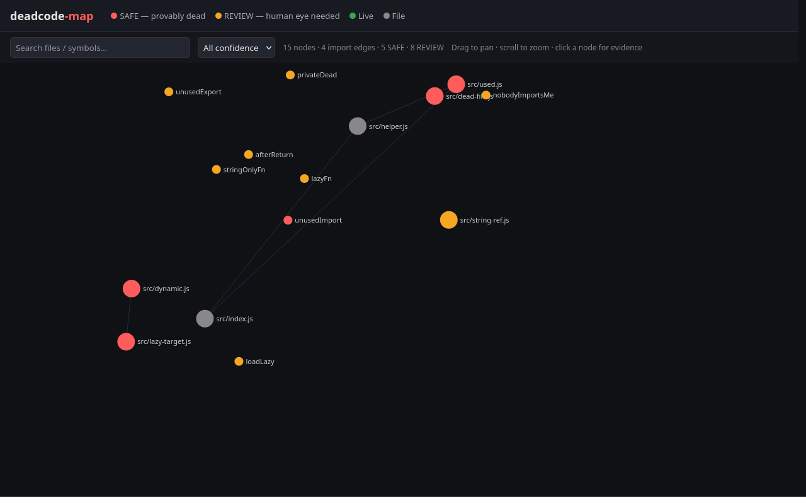

# deadcode-map

Find dead code, **prove** it is dead, and **see it on a map**.

Most dead-code tools print a list and walk away. deadcode-map does three things they don't:

1. **Confidence + evidence, not a boolean.** Every finding is graded `SAFE` / `REVIEW` / `KEEP` and carries its evidence: 0 importers, 0 callers, last git touch, test coverage, string mentions.
2. **The map is the product.** `deadcode-map --map` writes a single self-contained HTML file (no CDN, no server — open it by double-clicking). Dead nodes are red, review is amber, live is green. Click a node for why it was flagged, who doesn't call it, its git age, coverage, and the exact delete diff.
3. **Prove, don't just list.** `deadcode-map --prove` deletes SAFE candidates in an isolated git worktree, runs your test suite once per file-cluster, and reports `proven` / `breaks` / `skipped`. It bisects only if a cluster fails.

JS / TypeScript and Python in v1, one command, one mental model. Java (private-only) is supported too — see "Java scope" below.

## The map



A scan of the repo's own `fixtures/js-basic` fixture (9 files) rendered with
`deadcode-map fixtures/js-basic --map deadcode-map.html`. Red nodes are SAFE —
provably dead; amber nodes are REVIEW — a human should look; grey nodes are
files. Drag to pan, scroll to zoom, click a node for its evidence and the
exact delete diff. The map is one self-contained HTML file: no CDN, no server,
open it by double-clicking.

## Install

```sh
npm install -g deadcode-map
# or, without installing:
npx deadcode-map [path]
```

Requires Node.js 18+. The target repo needs no runtime: source is parsed with tree-sitter, never executed.

## Usage

```sh
deadcode-map [path]                 # scan the current directory
deadcode-map ./my-app --map deadcode-map.html
deadcode-map ./my-app --json report.json
deadcode-map ./my-app --fail-on safe        # CI: exit 1 on new SAFE dead code
deadcode-map ./my-app --baseline            # hide grandfathered findings
deadcode-map ./my-app --update-baseline     # record current findings as baseline
deadcode-map ./my-app --fix                 # delete SAFE findings only
deadcode-map ./my-app --prove               # prove SAFE deletions with your tests
deadcode-map ./my-app --prove --test-command "pytest -q"
deadcode-map ./my-app --include-fixtures    # also scan fixtures/ test-data dirs (excluded by default)
deadcode-map ./my-app --cache               # cache per-file parses; repeat scans are ~8-10x faster
deadcode-map ./my-app --cache --cache-stats # show cache hit rate after the scan
deadcode-map ./my-app --no-cache            # force a full scan, ignore the cache
deadcode-map mcp                            # start the MCP server on stdio (for AI tools)
```

## Use with AI tools

deadcode-map ships an MCP server (stdio) so AI coding tools can scan, explain, and safely clean up dead code in your repo. It exposes five tools — `scan_repo`, `explain_finding`, `fix_safe`, `get_map`, `status` — plus a `cleanup-dead-code` prompt and a `deadcode://map/{path}` resource serving the visual HTML map. `fix_safe` deletes SAFE findings only and refuses unless you pass `confirm: true`; it never touches REVIEW or KEEP. Requires Node.js 18+.

### Claude Code (plugin)

```sh
/plugin marketplace add ashudhanda/deadcode-map
/plugin install deadcode-map@deadcode-map
```

This installs the MCP server, the `deadcode-map` skill, and the `/deadcode-map` slash command. For local development without installing:

```sh
claude --plugin-dir ./deadcode-map
```

Or wire the MCP server by hand in `.mcp.json` (project) or `~/.claude.json` (global):

```json
{
  "mcpServers": {
    "deadcode-map": {
      "type": "stdio",
      "command": "npx",
      "args": ["-y", "deadcode-map", "mcp"]
    }
  }
}
```

### Claude Desktop

Add to `claude_desktop_config.json` (`~/Library/Application Support/Claude/` on macOS, `%APPDATA%/Claude/` on Windows, `~/.config/Claude/` on Linux), then restart Claude Desktop:

```json
{
  "mcpServers": {
    "deadcode-map": {
      "command": "npx",
      "args": ["-y", "deadcode-map", "mcp"]
    }
  }
}
```

### Codex CLI

In `~/.codex/config.toml`:

```toml
[mcp_servers.deadcode-map]
command = "npx"
args = ["-y", "deadcode-map", "mcp"]
```

Or add it from the command line (note: `env` does no `${VAR}` expansion in Codex — use `env_vars` to forward host variables):

```sh
codex mcp add deadcode-map -- npx -y deadcode-map mcp
```

### Cursor

In `.cursor/mcp.json` (project) or `~/.cursor/mcp.json` (global). Cursor requires `"type": "stdio"` on stdio entries:

```json
{
  "mcpServers": {
    "deadcode-map": {
      "type": "stdio",
      "command": "npx",
      "args": ["-y", "deadcode-map", "mcp"]
    }
  }
}
```

### Windsurf

Open the MCP config from inside Windsurf (Settings → MCP Servers) and add:

```json
{
  "mcpServers": {
    "deadcode-map": {
      "command": "npx",
      "args": ["-y", "deadcode-map", "mcp"]
    }
  }
}
```

The config file lives at `~/.config/devin/mcp_config.json` (current; older installs used `~/.codeium/windsurf/mcp_config.json`).

### VS Code Copilot

In `~/.copilot/mcp-config.json` (global) or a workspace `.mcp.json`:

```json
{
  "mcpServers": {
    "deadcode-map": {
      "type": "stdio",
      "command": "npx",
      "args": ["-y", "deadcode-map", "mcp"]
    }
  }
}
```

(Deprecated: `.vscode/mcp.json` with top-level `servers` — use the format above instead.)

### Gemini CLI

In `~/.gemini/settings.json` or a project `.gemini/settings.json` (env vars expand as `$VAR` / `${VAR}`). Verify with `/mcp list`:

```json
{
  "mcpServers": {
    "deadcode-map": {
      "command": "npx",
      "args": ["-y", "deadcode-map", "mcp"]
    }
  }
}
```

### OpenCode (v2)

In `opencode.json`. Note the v2 shape: `mcp.servers`, `type: "local"`, `command` is one array, env vars go under `environment`:

```json
{
  "mcp": {
    "servers": {
      "deadcode-map": {
        "type": "local",
        "command": ["npx", "-y", "deadcode-map", "mcp"],
        "environment": {},
        "disabled": false
      }
    }
  }
}
```

### Generic CLI agents (no MCP)

Any agent that can run shell commands can use the CLI directly — no MCP setup needed:

```sh
deadcode-map [path] --json -            # full JSON report on stdout (pure JSON, no terminal summary)
deadcode-map [path] --json report.json  # or write it to a file
deadcode-map [path] --map deadcode-map.html
deadcode-map [path] --fail-on safe      # CI: exit 1 on new SAFE dead code
deadcode-map [path] --baseline          # hide findings already in .deadcode-map.json
deadcode-map [path] --update-baseline   # record current findings as the baseline
deadcode-map [path] --prove             # prove SAFE deletions with your tests first
deadcode-map [path] --fix               # delete SAFE findings only
deadcode-map [path] --coverage report.xml  # test-coverage evidence (Cobertura XML or lcov); auto-detected when present
deadcode-map [path] --coverage coverage-dir/  # merge every report in a directory (union of covered lines)
deadcode-map [path] --no-coverage       # ignore coverage files entirely
```

Coverage is a one-way safety net: a symbol whose body lines ran under tests is demoted from would-be SAFE to REVIEW, never the other way round — coverage never promotes a REVIEW to SAFE, and a file with covered lines is never a SAFE dead file. Only the symbol's body lines count (the `def` line runs on import, so it is excluded). When no coverage file is given, the tool auto-detects `coverage.xml`, `coverage/coverage.xml`, `lcov.info`, or `coverage/lcov.info` in the scanned repo; pass `--coverage <file>` to point at a specific report, or `--coverage <directory>` to merge every report in the directory (a line counts as covered when any run covered it, so merging can only demote findings, never promote them). A single file input behaves exactly as before.

A `--json` report or `--map` file written inside the scanned repo is excluded from the scan itself, so repeat runs report identical findings — the tool's own output never counts as a reference to the symbols it lists. Only the exact output path is excluded; any other file, including one with the same name in another directory, is still scanned.

Exit codes: 0 ok, 1 `--fail-on` triggered, 2 usage error / no such directory. A repo guide for agents lives in [AGENTS.md](AGENTS.md).

Example output:

```
deadcode-map  /home/ashu/my-app
  34 findings — 2 SAFE · 25 REVIEW · 7 KEEP (hidden)
  SAFE dead code: ~74 bytes across 2 findings
  by category: file 5, function 22, import 1, unreachable 1, class 1, method 4

  SAFE   src/used.js:1 unusedImport
         imported "unusedImport" from "./helper" but never referenced in this file
  SAFE   src/used.js (unreachable)
         code after return/throw/break/continue
```

## Try it in the browser (no install)

Paste a public GitHub repo link at **https://ashudhanda.github.io/deadcode-map/** and check
dead code in the browser: summary counts, per-file findings, and a visual map. Your repo is
fetched straight from GitHub in your browser — nothing is uploaded anywhere. An optional
GitHub token raises the API rate limit from 60 to 5,000 requests/hour; it is kept only in
memory and never stored.

Honest limit: the web checker is a lightweight regex-based analyzer, not the full
tree-sitter CLI. It covers JS/TS and Python, caps at 500 files / 5 MB, and handles public
repos only. For full accuracy, `--prove`, and `--fix`, use the CLI above.

## What counts as dead

| Category | Definition |
|---|---|
| Dead file | No importer, not an entry point, not referenced by name anywhere |
| Dead export / function / class | Defined/exported, 0 importers/callers in the repo |
| Dead import / variable | Imported/declared, never referenced in its scope |
| Unreachable code | Code after `return` / `throw` / `break` / `continue`, `if (false)` branches |
| Dead dependency (JS) | In `package.json`, never imported/required, named in a script, or referenced by a code/config string — README prose does not count |

## What is never flagged SAFE

- **Entry points**: `package.json` main/bin/exports, `src/index` / `src/main`, `if __name__ == "__main__"` scripts, shebang CLI scripts, framework routes (`pages/`, `app/`), tests, stories, config, migrations.
- **Framework magic**: route handlers (`@app.route`, Next.js `getServerSideProps`), decorators, dunder / protocol methods (`__init__`, `__str__`), module dunder variables (`__version__`, `__author__`, `__all__` — read by the import system / packaging tooling), `__init__.py` re-exports. Framework rules live in `frameworks/*.json` and are loaded by default. Pydantic / dataclass / TypedDict model fields, `@overload` groups, `@model_validator` / `@field_validator`, `declare module` augmentation, and decorated methods (`@contextmanager`, `@property`) are framework-invoked — KEEP, never SAFE.
- **Re-exports are uses**: `import X as X`, `export { X }`, `# noqa: F401` imports, and compat-shim modules (`compat.py`, `_compat/`) are public API — their contents are REVIEW at most, never SAFE. A `tsconfig` / `jsconfig` `paths` alias (`@/*`) resolves like a relative import.
- **Test code and intentional dead code**: files under `tests/` / `test/` / `__tests__/` and files literally named `test.ts` / `test.tsx` are KEEP at most, never SAFE — and so is unreachable code marked `# pragma: no cover` or `/* istanbul ignore next */`.
- **Dynamic use**: anything in a file that uses dynamic `import()`, `require(variable)`, `importlib`, or `getattr` is REVIEW at most — never SAFE.
- **Public API of a published library**: exported symbols are REVIEW, never SAFE, never auto-deleted.
- **Methods**: a method with 0 in-repo callers is REVIEW at most — it could be called via an object or a framework.
- **Same-file use is alive**: a symbol called or referenced in its own file is never flagged — it is used, even if nothing else in the repo imports it.
- **Fixture / test-data directories are not scanned by default**: `fixtures/`, `__fixtures__/` at any depth (`test/fixtures`, `tests/fixtures`, …) are excluded — planted dead code in test data is not real dead code. Use `--include-fixtures` (CLI) or the checkbox in the web checker to scan them.

## False-positive defences (in priority order)

1. A real import/call graph built from entry points — no flat name-matching.
2. A string-reference pass: the symbol name is searched across the whole repo (code, config, templates) before flagging. Only code-like mentions count — the name as a whole string (`'named'`, `{"handler": "wired"}`) or delimited by code characters (`'handlers.named'`, `'./named'`). Words inside sentences (`'a named export is nice'`, a docstring, README prose) do not count, and `.md` / `.txt` files never count.
3. Coverage evidence demotes would-be SAFE to REVIEW: a symbol whose body lines ran under tests is REVIEW, never SAFE, even with no callers — coverage never promotes. Same-file liveness is reachability over per-definition reference scopes, so a helper used only by another dead symbol in the same live file is caught (methods are conduits only when their enclosing class is live — a helper called only from a method of a dead class is SAFE).
4. Dynamic-import / reflection detection downgrades to REVIEW.
5. Framework rule packs as data files (`frameworks/next.json`, `frameworks/fastapi.json`, …).
6. Confidence grading + `--min-confidence`; `--fix` / `--prove` act on SAFE only.
7. Baseline (`.deadcode-map.json`) + inline ignore (`// deadcode-map-ignore-next`, `# deadcode-map: ignore` — planned, see Roadmap).
8. `prove` as the final arbiter: if the tests pass without it, it is dead.
9. JSX-pragma imports: in a file that contains JSX, an imported `React`, `createElement`, `h`, `Fragment`, `jsx`, `jsxs`, or `jsxDEV` counts as used by the JSX transform — the factory is chosen at build level (`tsconfig` `jsx`/`jsxFactory`, babel preset, `@jsx` comment), which a per-file parser cannot see, so treating pragma bindings as transform-used is the only false-positive-safe rule. In a file with no JSX the same import is still flaggable. `memo`, `Component`, `Suspense`, `lazy` are not pragma names and stay flaggable.

## Measured results (checkable, not marketing)

Fixtures live in `fixtures/` with planted dead items and known live items. Run them with `npm test` (135 CLI tests passing, 1 skipped) and `node --test test/web-analyzer.test.js test/web-prototype-names.test.js` (84 web tests). New fixtures in batch 3: `js-same-file-cascade`, `py-same-file-cascade`, `js-file-stringrefs` — every live symbol in them is never flagged SAFE, every planted dead item is found at SAFE or REVIEW.

| Fixture | Files | SAFE found | SAFE false positives | SAFE FP rate |
|---|---|---|---|---|
| `js-basic` (JS, CommonJS + ESM) | 9 | 4 | 0 | **0%** |
| `py-basic` (Python, Flask + pytest) | 6 | 2 | 0 | **0%** |
| `py-relative` (Python, relative imports) | 7 | 1 | 0 | **0%** |
| `py-imports` (Python, dotted imports + module dunders) | 4 | 1 | 0 | **0%** |
| `py-multiline` (Python, parenthesized + backslash imports) | 2 | 3 | 0 | **0%** |
| `js-string` (JS, prose vs code-like string mentions) | 6 | 3 | 0 | **0%** |
| `py-string` (Python, docstring prose vs code-like mentions) | 4 | 1 | 0 | **0%** |
| `js-deps` (JS, dead dependencies: README prose vs real imports) | 5 | 0 | 0 | **0%** |
| `js-framework` (Next.js `pages/`) | 1 | 0 | 0 | **0%** |
| `py-class-attrs` (Python, config classes / external-base overrides / chained aliases / documented attrs) | 5 | 6 | 0 | **0%** |

### Real-repo benchmark (10 public repos + 3 diagnosis repos, CLI)

Measured 2026-11-23 with the current tool (batch 3 —
re-measure with `node ~/workspace/bench-repos/bench-run.js`). Before =
the tool at the start of batch 1 (corpus scan B / diagnosis numbers);
after = now. SAFE precision is hand-sampled per repo, not asserted
from the count.

| Repo | Files | SAFE before | SAFE after | Sampled SAFE precision after |
|---|---|---|---|---|
| express | 142 | 0 | 0 | — |
| commander | 159 | 3 | 0 | — |
| zustand | 49 | 5 | 0 | — |
| preact | 239 | 33 | 20 | 16/20 verified true (unused demo imports); 4 are JSX-pragma imports (`createElement`, `React`, `h`, `memo`, `Fragment`) the web counts as live — CLI gap, see limitations |
| date-fns | 1776 | 100 | 2 | 2/2 true (1 unused variable; 1 one-off jscodeshift codemod with no importer or script — true by the tool's model, manually-run tools are a known edge) |
| next-blog | 22 | 11 | 11 | 100% (unused React imports) |
| flask | 83 | 17 | 0 | — |
| fastapi | 1237 | 71 | 0 | — |
| requests | 37 | 33 | 2 | 100% (2 unused type aliases) |
| click | 91 | 2 | 0 | — |
| axios | 261 | 90 | 0 | — |
| typer | 645 | 43 | 5 | 5/5 true (re-sampled in batch 3; the 2 new ones are never-read `TyperGroup` class attributes) |
| umami | 1520 | 1044 | 38 | 38/38 true (re-sampled in batch 3; the 6 new ones are 5 dead helpers in `src/lib/react.ts` and 1 dead component file, `SettingsButton.tsx`) |
| **Total** | **3836 + 2426** | **1452** | **78** | **74 of 78 verified true; 4 preact JSX-pragma imports are a known CLI gap** |

What fixed the bulk of it, in order: re-exports counted as uses
(`import X as X`, `export { X }`, `# noqa: F401`, compat shims);
framework-invoked declarations kept live (Pydantic/dataclass/TypedDict
model fields, `@overload` groups, `@model_validator`, `declare module`
augmentation, decorated methods); type-position references (TS type
annotations, Python string annotations, TypeAlias values, `__all__`);
tsconfig `paths` aliases (`@/*` — umami's dominant family, 196 → 32);
`.js` → `.ts` import resolution; monorepo-private packages treated as
libraries; test files (`tests/`, `test.ts`) and intentional-unreachable
markers (`# pragma: no cover`, `/* istanbul ignore next */`) kept.
Batch 2 closed the last 6 corpus SAFE false positives — framework-
consumed class attributes (Pygments theme classes, external-base
overrides like Werkzeug's `default_mimetype`, chained-assignment
aliases, Sphinx-documented flags) — and ported the inverted string
index to the web checker, so web-only SAFE is now 0.
Batch 3 added same-file cascade (per-definition reference scopes;
methods are conduits), coverage demotion (Cobertura/lcov, one-way),
a fix for the 32 KiB parse limit (tree-sitter's node binding throws
past 32,768 bytes, so large files were silently treated as live —
55 of 6,278 corpus files, including fastapi's `routing.py`), Python
re-export comments (`# re-export` / `# backwards-compat` keep one
name, including span-wide `# noqa: F401` on multi-line imports),
and a fix for locals inflating file findings (a local named `url`
kept umami's `SettingsButton.tsx` at REVIEW by matching 116 files —
locals no longer count as file-level string references). The 9 new
SAFEs in batch 3 are all verified true: 5 dead helpers in umami's
`src/lib/react.ts`, the dead `SettingsButton.tsx` file, 2 never-read
`TyperGroup` class attributes, and date-fns' one-off codemod.

### Batch 7 update (2026-11-23, 15 public repos, 14,443 files)

Batch 5 expanded the corpus with five more repos (Vue, SvelteKit,
Django, NestJS, Pydantic). Batch 6 cut their CLI SAFE from 176 to 47;
batch 7 cut it to 26 — hand-judged one by one, **26/26 verified true
(100% SAFE precision)**. Re-measure with `node
~/workspace/bench-repos/bench-run.js` (old corpus) and the batch-6
after JSONs under `~/workspace/bench-repos/bench7-verify/` (expansion
repos); web numbers via `node ~/workspace/bench-repos/web-bench5.js`.

| Repo | Files | CLI SAFE batch 5 | CLI SAFE batch 6 | CLI SAFE batch 7 | SAFE precision batch 7 |
|---|---|---|---|---|---|
| vuejs-core | 522 | 9 | 9 | 0 | — |
| sveltejs-kit | 1579 | 6 | 0 | 0 | — |
| django-django | 3054 | 112 | 13 | 2 | 2/2 true (`globalThreshold`, `handles_files`) |
| nestjs-nest | 2284 | 49 | 25 | 24 | 24/24 true (9 dead `test.dto.ts` files, 4 unimported entity files, 2 unregistered `logging.plugin.ts` files, `audio.module.ts`, 8 unused imports) |
| pydantic-pydantic | 3168 | 0 | 0 | 0 | — |
| **Total** | **10,607** | **176** | **47** | **26** | **26/26 true** |

What fixed it in batch 7: type-test files (`*.test-d.ts(x)`, run by
`test-dts-only`) are entry points; workspace self-references (`vue` /
`@vue/*` imported from inside vuejs-core) count as uses; classic
(non-module) script globals resolve repo-wide (`quickElement` et al. in
Django's admin JS); module-level defs under grouping statements
(`if` / `try` / `with`) are visible, so `TYPE_CHECKING`-guarded
TypeAliases are correctly exported public API (REVIEW, never SAFE);
`__unittest` is KEEP; per-definition liveness fixed the NestJS
`missingFile` bug (a shared name merged a live const with a dead
method). The web checker got the same ports for case-insensitive
`# NOQA`, `*.e2e-spec.ts` test files, and try/except probe imports:
web SAFE 26 → 15 (django 16 → 7, nestjs 10 → 8, rest 0, maxDup 1×).
Web-only SAFE is now 6, all django, all known false positives whose
CLI fixes are not yet ported to the web: the 4 admin-`core.js` globals
(`quickElement`, `removeChildren`, `findPosX`, `findPosY`), the
`__unittest` variable, and the `replace` import. Web SAFE precision
is 9/15 (the other 9 overlap CLI SAFE and are verified true). The
batch-2 claim above that web-only SAFE is 0 is superseded by this
measurement.

Old corpus (10 repos + 3 diagnosis repos) re-measured at batch 7:
SAFE 45 → 42, with zero findings lost and zero new SAFE. The 3
changes are all SAFE → REVIEW demotions of exported TypeAlias /
TypeVar declarations (`CookiesType`, `ProxiesType` in requests,
`GrpType` in typer) — the conditional-def fix above. Four
`*.test-d.ts(x)` file findings disappeared (type tests are now entry
points) and 5 new REVIEW findings appeared (conditional-def variables
such as fastapi's `ujson` and click's `BEFORE_BAR` / `AFTER_BAR`) —
improved recall, same conservative grading. Remaining old-corpus SAFE:
preact 1 (`memo` in `demo/suspense.jsx` — the known JSX-pragma CLI
gap), date-fns 1 (the one-off `expectify.js` codemod), typer 4,
umami 36, everything else 0.

Java landed in the CLI in batch 6 (private-only SAFE:
tree-sitter-java, calls grouped by name + arity, field read-vs-write
tracking, fail-open on parse errors; exact-16 fixture SAFE set, 0
false SAFE). Batch 7 added framework packs as data —
`frameworks/spring.json` (61 keep-decorators, 20 class annotations)
and `frameworks/jackson-jpa.json` (59 + 9) — and a fix for imports
used only by annotations (`@JsonProperty`) wrongly graded SAFE. Web
checker Java support was deliberately not shipped: a regex port
cannot meet the "never a SAFE the CLI would not" bar (no scopes, no
arity channel, field read-vs-write needs binding resolution); it
needs a real scanner, not regex.

Scan times (same machine): umami 1520 files 15.6 s (~97 files/s),
fastapi 1237 files 12.9 s, date-fns 1776 files 8.6 s — the O(symbols ×
files) string pass is now an inverted index and git is one `git log`
per repo instead of two processes per file (umami was 173.9 s before).
Repeat scans with `--cache` are ~8–10× faster (content-hash parse
cache, warm findings identical to cold): fastapi cold 13.0 s → warm
1.3 s (99% hit rate), date-fns cold ~8.5 s → warm ~0.9 s. The cache is
off by default; `--no-cache` forces a full scan.

Determinism note: a single CLI run is not ground truth on Python repos
unless the tool version is pinned — an earlier measurement gap (flask
39 vs 17 SAFE across runs) turned out to be a tool-version change
mid-measurement, not nondeterminism: the current tool is byte-identical
across 3 repeat runs on flask/requests/click.

The web checker (`docs/analyzer.js`, regex-based) reproduces the same SAFE findings on every fixture above — verified by the web test suite (70 tests). On the 10-repo corpus it no longer crashes on any repo, emits no duplicate finding IDs, and every web SAFE is also a CLI SAFE (web-only SAFE: 0). Batch 4 fixed web multi-line `import`/`require`/re-export handling (continuation lines no longer leak into the references pass) and decided the JSX-pragma rule (see "False-positive defences" above); measured on the same clones, web SAFE is 2 vs CLI SAFE 4, at full parity on preact (1 = 1) and next-blog (0 = 0) — the only remaining gap is requests, where the web checker misses 2 CLI SAFE variables in `src/requests/_types.py`. It is also now faster than the CLI on large repos — the inverted string index was ported to it (fastapi 0.8 s web vs 12.6 s CLI; whole 10-repo corpus ~3 s web). The CLI is still the reference for the few shapes the web misses (see limitations).

Dogfood — deadcode-map run on itself: **0 findings**. The repo scans clean: fixture/test-data directories are excluded by default, same-file use counts as alive, and the one genuinely dead helper (`named` in `src/parse-js.js`) was deleted. With `--include-fixtures` the planted fixture data still reports (250 findings, 0 in `src/`), which is the point of the fixtures.

A real-repo check on a Python project (a Raspberry Pi / Arduino gateway script) first flagged the runnable `__main__` script as a dead file — that false positive is now a regression test (`run.py` in `py-basic`), and the same repo now reports 0 SAFE.

Known limitations, stated honestly:

- **Java scope (private-only)**: SAFE applies only to private methods (including `private static`), private fields, private constructors, unused imports (never on-demand `import foo.*`), and unused locals of private methods. Unused parameters are REVIEW, never SAFE: deleting one changes the method's arity, so every call site would break, and `--fix` only deletes the declaration. Everything else in Java — public, protected, and package-private members, whole classes — is REVIEW at most, never SAFE, and Java files are never dead-file candidates (there is no Java import resolution yet, so a file cannot be proven unimported). Overloads are told apart by (name, arity) only: same-name, same-arity overloads (`process(int)` vs `process(String)`) are one unit — a call to one keeps both alive. A varargs method matches any call with arity >= its fixed arity. Any annotation on a private member keeps it (`@PostConstruct`, `@JsonProperty`, `@Autowired`, ...), as does a framework stereotype on its enclosing class (Spring, JPA, Lombok), `native`, and `serialVersionUID`. The Spring and Jackson/JPA annotation lists live as data in `frameworks/spring.json` and `frameworks/jackson-jpa.json` (a pack-only stereotype such as `@ControllerAdvice` or `@JsonIgnoreProperties` keeps members at REVIEW too). An import used only by an annotation (`@JsonProperty`) is live — deleting it would break compilation. A name mentioned in any string — Java source, Spring/MyBatis XML, `application.properties`, YAML — downgrades to REVIEW; names built by string concatenation (`"by" + "NameOnly"`) are undetectable and remain a documented caveat. Test sources (`src/test/java`, `*Test.java`) are KEEP at most, never SAFE. `--prove` runs `mvn -q test` / `./gradlew test` (15-minute timeout) when Maven/Gradle is installed. The web checker does not support Java (CLI only). Fixtures are validated with tree-sitter (0 ERROR nodes), not `javac`.
- **Web/CLI parity**: the web checker is regex-based, so it misses some things the CLI catches. Measured on the same 10-repo corpus with config files included (`node ~/workspace/bench-repos/web-bench-full.js`): web SAFE 2 vs CLI SAFE 4, web-only SAFE 0 — every web SAFE is also a CLI SAFE. The remaining gap is requests, where the web checker misses 2 CLI SAFE variables in `src/requests/_types.py`. Same-id duplicate findings: 0 on every repo (verified) — the remaining "max per key" counts are repeated definitions of one name in a test file, mostly KEEP. The CLI is the reference; the web checker is a convenience.
- **A name that appears as a whole string or a code-delimited string** still counts as a reference, even when the string is not a real dynamic lookup — for example a test file asserting on the symbol by name (`bySymbol(f, 'src/index.js', 'render')`). Those findings land in REVIEW, never SAFE, so the cost is noise, not a false deletion. The same shape applies to the dead-dependency check: a dependency named in a config value (e.g. `"theme": "chalk"`) counts as used, and a dependency name that is a prefix of a longer hyphenated name (`left-pad` inside `left-pad-x`) can also count — both are REVIEW noise, never a false deletion.

## How it works

```
discover  →  parse (tree-sitter)  →  import/call graph  →  confidence + evidence
     ↑ git age / churn                     ↑ string-reference pass
     ↑ coverage.xml (if present)           ↑ framework packs
     └─→ CLI / JSON / --fail-on / baseline ─→ HTML map ─→ --fix ─→ --prove
```

- `src/discover.js` — file walk + entry-point detection.
- `src/parse-js.js`, `src/parse-py.js`, `src/parse-java.js` — tree-sitter parsers (imports, exports, definitions, calls, dynamic imports, unreachable code, decorators).
- `src/graph.js` — import resolution (relative, ESM, CommonJS `require`, dynamic `import()`, Python sibling modules), reachability from entry points, per-symbol usage.
- `src/confidence.js` — SAFE / REVIEW / KEEP grading with evidence.
- `src/git.js`, `src/coverage.js` — git age/churn and Cobertura coverage evidence.
- `src/map.js` — single-file offline HTML map (canvas force graph, no CDN).
- `src/fix.js` — SAFE-only deletion, one file at a time.
- `src/prove.js` — isolated git worktree + test run, batched by file cluster, bisect on failure.
- `src/baseline.js` — `.deadcode-map.json` grandfathering for CI.

## Roadmap

- v0.1.0 (shipped): MCP server + Claude Code plugin + AI-tool configs (see "Use with AI tools").
- v1.1: Java (private-only SAFE — private methods/fields/constructors, unused imports, unused locals on private methods; parameters are REVIEW — removing one needs call-site updates; public Java is REVIEW-only — it cannot be proven statically).
- Framework packs: Django, Angular, Spring, pytest (more), Vue, Svelte.
- `--diff` / `--since` for PRs: "what did *this PR* leave dead?"
- Inline ignore comments (`// deadcode-map-ignore-next`).
- Interactive approve / reject / keep-with-reason in the map.

## Why this exists

Knip (~13k stars) is the JS/TS incumbent and Vulture (~5k) is the Python standard, but both are terminal lists with well-documented false positives on dynamic imports, lazy loading, and framework code — and neither proves a deletion is safe or shows you a map. deadcode-map wins on prove + map + multi-language + false-positive-first trust. If v1 were just a terminal list, it would not ship.

## License

MIT. See [LICENSE](LICENSE).
